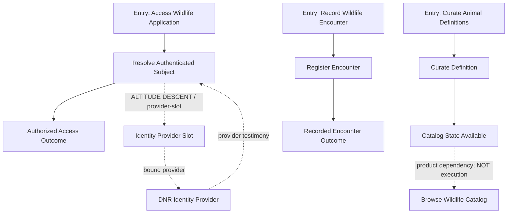

# OV3 Build Specification — Estate-Rooted Workflow Discovery & Faithful Reveal

**Specification ID:** `ov3.estate-workflow-discovery.v1`  
**Status:** PROPOSED IMPLEMENTATION SPECIFICATION — NOT ADMITTED, NOT EXECUTED  
**Owner of desired outcome:** SideFX / OV3 authoring network  
**Primary implementation target:** existing SideFX server-side capability estate and its existing SDA kernel, query/projection and observation surfaces  
**Example / regression domain:** DNR wildlife architecture challenge (four-page Nerdery brief)  
**Scope:** **Phase A** correctly derive, inspect, render, and verify estate-owned workflows without elevating providers, product dependencies, UI links, or a Mermaid diagram into execution authority. **Phase B** apply that verified model to author and realize the DNR wildlife reference estate (after an explicit Phase A admission gate).

## 0. OV3 mission and promised result

**Mission:** Build a declared, inspectable workflow-revelation capability that resolves workflow entry points and their executable downstream routes *from admitted scenario authority*, while preserving the existing canonical blueprint, graph semantics, execution boundaries, and provider isolation.

**Promised experience:** A user can open an estate/capability, select an admitted workflow entry, see every declared downstream lane, branching decision, convergence, and terminal, and zoom into each event's provider mechanics without the display altering the graph's meaning. A user can also ask *why* a displayed route exists and receive its canonical source reference and admission status.

**Primary acceptance sentence:** “What SideFX displays as a workflow is exactly the admitted executable progression; physical suppliers and consumable products appear as related but distinct connections, never as invented roots or automatic execution edges.”

**Stop condition:** If required semantics are absent from the inspected estate, return a precise `NOT_DECLARED` / `NOT_VERIFIABLE` finding. Do not infer missing semantics from layout, naming, topological indegree, Gherkin prose, a product dependency, or an LLM explanation.

### Explicit non-goals

- Do **not** build a new generic workflow engine, planner, database authority, provider registry, or authorization plane.
- Do **not** rewrite the SDA kernel, import a client-side implementation as proof of server capability, or introduce hand-authored consumer execution logic.
- Do **not** install a wildlife application **during Phase A** or claim the wildlife estate is admitted. During Phase A it is a negative/positive **test specimen**; Phase B may create and verify the reference application through existing change/admission procedures.
- Do **not** turn `DNR Identity Provider` into a scenario, capsule, or entry point merely to preserve the superficial count of four roots.
- Do **not** treat graph reachability across arbitrary relationships as runtime execution.
- Do **not** invent CLI/API commands, tables, procedures, mechanics, or schema fields without finding and binding the equivalent admitted surface or obtaining explicit approval for a genuine extension.

## 1. Authority precedence and scope

Inspect live server-side authority before design or mutation. Reuse what exists. The following distinctions are mandatory:

1. **Canonical scenario authority:** a Scenario is Input → Event → Outcome/Experience. The Event's execution authority can descend into operations, mechanics, provider slots and physical providers.
2. **Canonical blueprint:** machine-readable typed graph authority; Mermaid, ASCII, SVG, UI, video, and workflow views are *projections*.
3. **Graph geometry:** honor the existing ADR-001 node kinds (`state`, `responsibility`, `outcome`, `junction`, `convergence`, `provider-slot`, `terminal`) and edge dimensions, including topology, contract relation, semantic progress, and selecting variant. Relevant topology vocabulary: `TRANSITION`, `BRANCH_ROUTE`, `FAN_OUT_MEMBER`, `CONVERGENCE_REQUIREMENT`, `ALTITUDE_DESCENT`, `BOUNDED_RETURN`.
4. **Estate backplane:** admitted products, contract satisfaction, capability dependencies and shared scenario identity are separate from invocation/transition semantics. A product becomes available; it does not automatically invoke all its consumers.
5. **Provider realization:** provider binding and provider testimony belong underneath an event's responsibility. External systems may emit signals; an estate-owned ingress scenario admits and acts on them.
6. **Installed kernel & server:** the desktop, screenshot, client repo, or local command environment is not evidence of available server resolvers. Observe actual `sfx-api` and current server SDA bindings before making compatibility claims.
7. **Candidate vs admitted:** documents, fixtures, and expected results supplied in this package are candidates; only live source snapshots and real receipts can establish actual admission or runtime behavior.

If the existing graph format does not encode a required distinction, produce an **authority-gap finding** with exact source pointers and an extension proposal. Do not add a parallel “workflow authority” that competes with canonical scenarios/transitions.

## 2. Definitions (normative within this proposed specification)

- **Workflow entry:** an *estate-owned, declared, independently addressable scenario entry* that may initiate execution under an admitted input and authorization context. It may be invoked by UI, CLI, API, schedule, message, webhook, or polling; its identity never belongs to that transport or provider.
- **Workflow:** the executable subgraph reachable from **one declared entry** by following **only** validated, admitted scenario-level execution transitions, respecting variant selection, fan-out, convergence, terminal and bounded-return laws. It may contain shared scenarios and multiple terminal dispositions.
- **Workflow lens:** a read-only projection of the workflow portion of the canonical graph. It neither creates a new execution graph nor admits any route.
- **Product dependency:** a typed relation by which an admitted product may satisfy another capability's input; it does not imply that the downstream consumer automatically executes.
- **Provider binding:** a subordinate connection from responsibility/mechanic/provider slot to a realized provider. It is not a workflow transition.
- **Signal ingress:** an estate-owned scenario that receives or polls an external source, admits the received signal, and then may advance through declared transitions. The external provider is *not* the root.
- **Candidate root:** a graph node appearing to have no inbound arrow in a particular rendering. Candidate roots are *not* workflow roots absent entry authority.
- **Shared downstream scenario:** one canonical scenario identity reachable from more than one admitted workflow entry. Do not duplicate the scenario to make the drawing look like independent lanes.

**Non-negotiable:** zero incoming edges is neither necessary nor sufficient for workflow-entry status. An independently invocable scenario can have inbound edges from another scenario. A provider can have zero inbound edges in a simplistic view and still never be a workflow entry.

## 3. Root-and-edge resolution contract

### 3.1 Root eligibility

An entry is eligible only when its source evidence establishes all of the following:

- canonical scenario/capability identity (not a provider ID);
- declared execution-entry eligibility or an existing equivalent admitted interface/entry binding;
- input and expected outcome contract references;
- executable authority resolvable for that entry;
- applicable authorization/admission disposition;
- a pinned authority snapshot/digest and source pointers.

Do **not** infer an entry from `in-degree == 0`, top placement, noun/verb naming, clickable UI, or existence of an HTTP endpoint alone. Interfaces must resolve back to admitted scenario entry authority.

### 3.2 Edge classification and traversal

For **workflow progression**, traverse only scenario-level, admitted, executable route edges whose topology and semantic-progress dimensions authorize progression. Honor `TRANSITION`, `BRANCH_ROUTE`, `FAN_OUT_MEMBER`, and the documented composition behavior of `CONVERGENCE_REQUIREMENT`. Do not treat a convergence *input requirement* itself as a free-standing invocation if the governing authority requires additional readiness/transition evidence. Respect declared `BOUNDED_RETURN` only under its explicit bound and return law.

`ALTITUDE_DESCENT` is **not** a new workflow lane. Use it for drill-down into Event → responsibility → mechanic → provider slot → provider. Evidence contracts back separately.

Product/contract dependency, catalog lookup, UI navigation, actor relationship, provider binding, provider testimony, and unknown edges must be excluded from the workflow-transition traversal. They may be shown in explicitly labeled companion overlays.

**Fail closed:** An edge with missing topology, missing mandatory progress, unknown selecting variant, unresolved source identity, or unsupported cross-altitude semantics is not eligible for workflow traversal. It produces an inspectable finding, not a best-guess solid arrow.

### 3.3 Branching and shared flow laws

- `BRANCH_ROUTE`: selected by a declared outcome variant; do not render as concurrent fan-out.
- `FAN_OUT_MEMBER`: required concurrent/independent obligations; do not render as exclusive alternatives.
- `CONVERGENCE_REQUIREMENT`: declare which products *jointly* establish readiness; multiple incoming arrows alone never imply convergence.
- `TRANSITION`: advance according to admitted contracts and progress semantics.
- `BOUNDED_RETURN`: valid only if the governing authority specifies the bound; no unbounded traversal or hidden loop.
- Shared downstream scenario: reference same semantic ID in every workflow view; do not clone authority.
- Multiple terminal outcomes: preserve all admitted dispositions; do not invent a single green success terminal.

## 4. Wildlife regression specimen: original diagram is intentionally invalid

The October 31 conceptual diagram showed these visual roots: `Curate Animal Attributes`, `Curate Animal Definitions`, `DNR Identity Provider`, `Queue Offline Encounter`. It placed unlabeled arrows such as `DNR Identity Provider → Access Wildlife Application`, `Curate Animal Definitions → Browse Wildlife Catalog`, `Browse Wildlife Catalog → Record Wildlife Encounter`, and `Record Wildlife Encounter → View Wildlife Collection`. Those arrows mix **provider supply, product dependency, possible UI navigation, and scenario progression**. They MUST NOT be imported as executable workflow routes.

### Required example interpretation

1. `DNR Identity Provider` is a provider candidate. A proposed entry such as `access-wildlife-application` may invoke a `resolve-authenticated-subject` responsibility using a **declared identity provider slot**; its provider is a subordinate realization.
2. If DNR emits a role-change event, the proposed entry is `admit-identity-change-event` or an existing equivalent estate ingress capability. The DNR system supplies input; it does not become the workflow root.
3. `curate-animal-attributes` can produce updated attribute data. `reveal-animal-knowledge` may read it later. That dependency alone does not mean the curation workflow executes the reveal workflow.
4. `curate-animal-definitions` can produce catalog data; `browse-wildlife-catalog` may consume it. Browsing is not automatically launched by catalog edits.
5. `queue-offline-encounter` yields a pending capture. Synchronization becomes a real workflow route only if explicitly declared. A successful synchronization can submit to the same encounter registration responsibility, avoiding a second identity for the same domain effect.
6. `record-wildlife-encounter` may be **its own independent workflow entry** even if also called by a synchronized-offline path. Likewise collection viewing may be independently invoked.
7. No statement of “four real workflows,” “two executable lanes,” or “three-way convergence” is valid without the respective admitted entry/edge/readiness authority.

### Minimal corrected conceptual example (not a canonical graph)



**Caution:** The lines between abstract example boxes are explanatory. They cannot be declared as canonical transitions without authentic scenario/port/outcome references, contract compatibility, and admission. The actual workflow diagram MUST be generated only from authoritative graph facts.

## 5. Required inspection capability and interfaces

**Proposed capability identity (candidate only):** `reveal-estate-workflows` (reuse/rename if equivalent estate capability already exists).

**Input intention:** pinned estate or capability snapshot; optional exact `entryScenarioId`; requested view (`workflow`, `workflow-and-products`, `workflow-and-providers`, `execution-observation`); reader authorization context; optional execution ID for testimony playback.

**Outcome / experience:** a user sees only attributable workflow roots and route projections; inspecting any node/edge exposes semantic identity, topology, contract binding, progress, source authority digest, and admission state. An empty or unresolved result is honestly reported rather than padded with guessed roots.

**Conceptual read-only output shape:** `snapshotRef`, `sourceDigest`, `entries[]`, `workflows[]`, `nodesBySemanticId`, `executionEdges[]`, `productRelations[]`, `providerBindings[]`, `evidenceRefs[]`, `findings[]`, `projectionDigest`, `disposition`. Reuse/adapt current canonical projection and receipt contracts: these field names are **illustrative** until matched to existing schemas.

**Required user capabilities:**

- List declared workflow entries, with status: admitted, candidate, held/unresolved.
- Select an entry and highlight *only* its admitted executable downstream subgraph.
- Expand a scenario to its Input → Event → Outcome and descend from Event to operations/mechanics/provider slot and bound provider.
- Toggle companion overlays for product dependencies and provider bindings without changing route membership.
- Trace a rendered edge to source: exact semantic ID, graph and authority digest, declared topology/progress, contract/variant, and existing source pointer.
- Overlay **real** run testimony and replay, never expected/fixture values mislabeled as executed.
- Compare two views/projection formats of one snapshot and prove semantic parity.
- Report and explain a held workflow and continue rendering unaffected, independently admitted workflows.

**Delivery:** prefer existing `sfx-api` server authority/read surfaces; CLI first for inspection and deterministic output; optional UI/graph view after proof. All deliveries consume the same declared interpretation. Do not add a frontend-specific graph-discovery algorithm.

## 6. Proposed canonical scenario for the inspection capability

```gherkin
@capability:reveal-estate-workflows
@scenario:reveal-admitted-workflow
Feature: Reveal governed workflow topology
  As a SideFX estate reviewer
  I want to inspect executable workflow progression from its admitted entry
  So that providers and product dependencies cannot masquerade as workflow routes

  Scenario: Reveal one admitted workflow
    Given an authorized inspection request and a pinned canonical estate graph
    When the admitted workflow routes are resolved
    Then a faithful inspectable workflow projection is available
```

The event may decompose into bounded scenario/operation cells for: pin/read source → resolve entry eligibility → classify edges → derive route closure → preserve shared identities/convergence → project requested lens → prove projection parity → return evidence-bearing result. These are responsibilities to map to *existing* transformations, queries, and generic mechanics first, not automatic new kernel primitives.

## 7. Invariants and proof requirements

**A. Authority fidelity:** identical pinned canonical graph and projection profile produce identical canonical result bytes/digest under the declared canonicalization policy; no surface silently re-authors a node/edge.

**B. Altitude integrity:** provider IDs never appear as workflow-entry scenario IDs; provider binding appears only as subordinate authority descent/overlay. Provider testimony never changes the admitted outcome without validated result/admission.

**C. Edge integrity:** every solid execution arrow corresponds one-to-one with an admitted execution transition and carries its semantic identity; no solid arrows from product-only or provider-only relations.

**D. Root integrity:** eligible entries are determined from explicit scenario/interface admission, not graph indegree. A scenario with inbound edges can still be an independent entry when explicitly admitted.

**E. Fan/branch/convergence integrity:** variants, joint readiness, fan-out membership and bounded returns retain their original semantics.

**F. Projection parity:** Mermaid, ASCII, API JSON, and UI projections (only for supported/admitted targets) preserve same semantic root set, graph identities, route membership and edge classifications. Layout changes may vary; meaning cannot.

**G. Local HOLD:** one malformed candidate/provider/edge does not erase independent, proven workflow entries. Hold the affected route and dependent paths only; preserve precise findings.

**H. Read-only inspection:** revelation does not mutate capabilities, admission, ledger, bindings, provider config, or executed state.

**I. Security and observation:** inspect only information authorized to the requesting subject; sensitive provider credentials cannot appear in graph overlays or receipts; expected fixtures are never live proof.

**J. No redundant execution substrate:** reuse admitted server kernel/resolvers and declared read/query mechanics. Any genuinely missing primitive is raised as a bounded platform-provider/kernel-change request, with cross-language impact and explicit review.

## 8. OV3 flight plan and parallel work packages

OV3 remains the orchestrator/admission boundary. Frontier inference may **propose** a plan and promise; it cannot grant itself filesystem, database, API, or production execution authority. OV3 approves a bounded plan, assigns tasks to existing permitted estate agents/capabilities, collects evidence, and only promotes after applicable gates close. The work packages below are *assignments*, not a request to create eight new service identities.

| Package | Responsibility | Deliverable | Required gate |
|---|---|---|---|
| **W0 — Discover** | Inspect current server authority, relevant existing Reveal/canonical blueprint capabilities, graphs, views, admission and tests | Source-grounded inventory and reuse map, exact digests; no edits | Architecture boundary confirmed; unknowns explicitly held |
| **W1 — Classify** | Establish source-backed entry eligibility, typed edge classifications, exclusion rules | Minimal authoritative derivation plan; source pointers; no new DSL if existing carrier suffices | Provider/product edges excluded from execution routes |
| **W2 — Seed RED** | Encode the original flawed wildlife diagram as a **negative** fixture and accepted counterexamples | Invalid graph specimen plus at least 12 focused BDD acceptance vectors | Existing output demonstrably fails when semantics are conflated |
| **W3 — Resolve** | Implement the smallest declared query/transformation path using admitted primitives | Candidate `reveal-estate-workflows` graph or reuse existing capability | Root and route closure correct; unsupported semantics remain held |
| **W4 — Project** | Reuse existing Mermaid/ASCII/JSON/UI projection mechanics and semantic references | Workflow lens with provider/product overlays, inspection hooks | Structural parity and no graph rewrites |
| **W5 — Observe** | Bind existing execution/testimony and replay read paths | Observed vs declared workflow overlay | No synthetic success receipts; evidence lineage reaches execution root |
| **W6 — Adversarial** | Prove negative and cross-apply cases, concurrency/read consistency, local HOLD behavior | Machine-readable conformance and findings | All normative fixtures pass in admitted target(s) |
| **W7 — Admit and Publish** | Route through the existing SideFX change/admission/promotion lifecycle | Immutable capsule or equivalent admitted capability product and receipts | Authorized approval, digest parity, publish + inspect actual server state |

**Sequencing:** W0–W1 before any authoritative mutation; W2 intentionally RED; W3 must produce one real end-to-end result before extra UI engineering; W4/W5 may progress independently after W3's contracts freeze; W6 gates W7. Continue independent tasks on local HOLD; do not advertise global completion from partial green tests. **After W7**, proceed into the separately gated **Phase B wildlife reference build** in `WILDLIFE-ESTATE-BUILD-PROFILE.md`; do not mistake validation of the workflow lens for delivery of the wildlife application.

### Flight plan input

```json
{
  "missionId": "ov3-estate-workflow-fidelity-v1",
  "promise": "Reveal only estate-admitted workflow routes from scenario entries while separating providers and products",
  "scope": "workflow-discovery-and-reveal",
  "initialMode": "READ_ONLY_DISCOVERY",
  "sourceSpec": "ov3.estate-workflow-discovery.v1",
  "authoringSurface": "existing-server-side-SideFX-estate",
  "mutationPolicy": "none-before-W0-W1-gates",
  "evidencePolicy": "exact-IDs-digests-provenance-real-receipts",
  "deliverySlices": ["source-inventory", "negative-fixtures", "one-inspectable-workflow", "cross-apply", "admission"]
}
```

This is an **illustrative mission envelope**, not a claim to match an installed OV3 request schema. OV3 must translate/bind it to the real contract before submitting execution.

## 9. Acceptance matrix — mandatory negative and positive scenarios

A machine-readable fixture pack and Gherkin cases accompany this document. The following behaviors MUST be tested independently:

1. Provider with no incoming graph arrow is **not** a workflow entry.
2. A legitimate declared entry with an incoming scenario route **is** a workflow entry.
3. A catalog/attribute product dependency does **not** become a transition.
4. An HTTP/UI navigation link does **not** become a scenario edge.
5. A declared transition preserves identity, contract and semantic progress.
6. Branch routes remain alternative and variant-selected.
7. Fan-out members remain jointly required as declared.
8. Convergence readiness requires its explicitly declared product set; mere indegree is insufficient.
9. Provider invocation appears at lower altitude with return testimony, not as scenario progression.
10. External webhook/poll event enters via an admitted estate ingress scenario.
11. Two workflow entries may share a downstream scenario without copying its identity.
12. A held edge does not erase independent admitted workflows.
13. Same authoritative snapshot produces semantically identical JSON/Mermaid/ASCII projections.
14. Fixture expectations cannot render as live execution testimony.
15. Unauthorized viewer cannot inspect restricted graph/provider facts.
16. Offline capture → synchronization → registration is a real route **only** when the corresponding transitions are admitted.
17. A provider swap with equivalent admitted mechanic contracts does not change workflow roots or scenario route membership.
18. Unknown topology/progress produces a finding instead of a fabricated arrow.

## 10. Exit criteria and required OV3 final report

OV3 should declare this mission **COMPLETE** only when it can furnish:

- actual deployed/read SideFX server authority source, snapshot identity and digest;
- real admitted root identities and rationale for each (with source pointers);
- separate inventories of `executionRoutes`, `productDependencies` and `providerBindings` resolved from the **same** snapshot;
- real runnable CLI/API inspection path or an explicitly held delivery boundary;
- canonical/realized/observed digest references where those are available; no invented digests;
- expected versus observed fixture dispositions with negative tests;
- projection parity report across the targets *actually* admitted;
- evidence of one full root → routes → terminals inspection and event → provider descent;
- unchanged admitted scenario/blueprint authority where this was projection-only;
- exact authority gap report and requested change/owner for anything not closed;
- signed/recorded promotion/admission receipt **only if** the existing change lifecycle actually produced it.

**Dispositions:** `COMPLETE`, `PARTIAL_WITH_HELD_GAPS`, or `NOT_ADMITTED`. Never conflate `candidate specification written`, `fixture valid`, `graph projected`, `provider invoked`, `workflow executed`, and `promised outcome evidenced`.

## 11. Source grounding and open questions

**Sources inspected for this proposal:** user-provided four-page Architecture Design Challenge; the original Wildlife SideFX Estate Candidate package; `adr-001-design-identity-capability-capsules(1).md` (typed blueprint graph and projection laws); `architecture-achieved.md` (declared DB estate, installed C# executor, source/evidence distinctions); `sidefx-architecture-decision-rubric.md` (smallest complete effect, no premature platform expansion); user conversation identifying the DNR provider-root inconsistency.

**Do not assume from these historical documents that the current live server implementation, query contract, or OV3 agent inventory is unchanged.** W0 must verify current authority and API access. Unresolved implementation decisions are deliberately left open where the live estate must answer them: the exact existing mechanism for entry eligibility, whether workflow traversal already exists, the current approved read interface, whether conformance supports new lens parity without a kernel change, and which roles/capabilities are presently delegated to OV3.

**Phase A final product:** one rooted, faithful, source-inspectable workflow lens over the real SideFX estate, demonstrated with the wildlife provider-root defect as a regression test—not another elegant diagram unsupported by executable authority. **Phase B final product:** a separately admitted DNR wildlife reference estate realized through the same principles and verified against the complete challenge requirements; see companion build profile.
