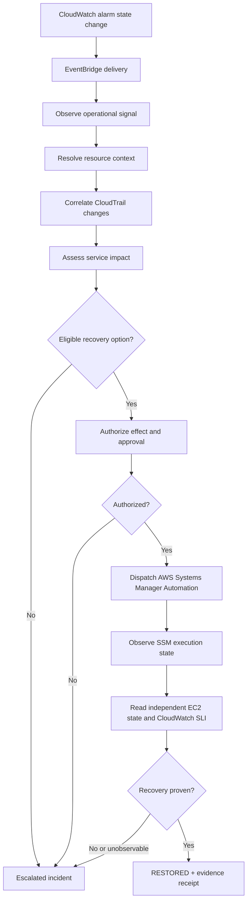

# SideFX Cloud Operations — target architecture for an AWS estate

## Product promise

Cloud operations teams can observe a condition, understand its affected business service, select and authorize a permitted intervention, exercise a bounded AWS provider, and independently verify whether service has been restored. The system retains evidence even when recovery is refused, held, or escalated.

## Scenario circuit

**Graph is a presentation sketch**, not an authoritative SideFX blueprint. Each capability is a separate declared terminal circuit, composed only by explicit typed outcome-product → input bindings. Event sequencing is declared in the estate; this picture does not create it.

## Decision layers

- Cloud operations meaning: affected service and required recovery experience.
- SideFX capability authority: contracts, scenario events, obligations, effect admission, outcome variants.
- AWS provider bindings: CloudWatch/EventBridge/Config/CloudTrail/STS/SSM and workload-specific APIs.
- Physical AWS: read, runbook approval/execution, resource state, metrics.
- Evidence: provider response, exact request/attempt, CloudTrail trace where applicable, independent post-action service state, outcome receipt.

## Auth and threat model

An external actor may **propose** a remediation but cannot self-assert a privileged subject, approval, AWS ARN scope, or a provider response. Secure event ingress, assume scoped roles with temporary credentials, match account/Region/resource and policy, require external AWS approval when the runbook specifies it, and never allow a model or untrusted JSON event to bypass effect authority. Separate read-only observation role from write-scoped execution role. Keep authorization effective at dispatch (not only at approval), because target state and authority can change.

## Delivery guarantees and uncertainty

EventBridge rule-target delivery may retry; configure a DLQ where needed. Case idempotency binds one event/action and token to its execution identity, with an explicit reconciliation step after ambiguous transport failure. A CloudWatch alarm is an observation, not a root-cause diagnosis. AWS Config has coverage/refresh limits. A CloudTrail match is evidence that an API was called, not proof that it caused an outage. A returned SSM Automation execution ID proves dispatch, not completion. A completed runbook is not customer-experience recovery. A missing metric is NOT_OBSERVABLE, never HEALTHY.

## Operational ownership

An Operations Manager sets recovery objectives and service-level targets, delegates roles with least privilege, owns incident severity and escalation policy, reviews runbook risk, ensures on-call readiness, operates change windows, observes FinOps and security posture, rehearses recovery, and uses actual measured evidence for postmortems. SideFX is intended to make these obligations inspectable; it does not assume them away.

## AWS deployment option, not requirement

EventBridge can deliver to a narrowly exposed ingress through an authorized API target, API Gateway/Lambda, or an approved queue/consumer. A server-side SideFX API remains the consumer-facing authority boundary; AWS provides transport and physical mechanics. Choose an actual deployment from tenant network/IAM constraints and observed throughput, not from this conceptual diagram.
